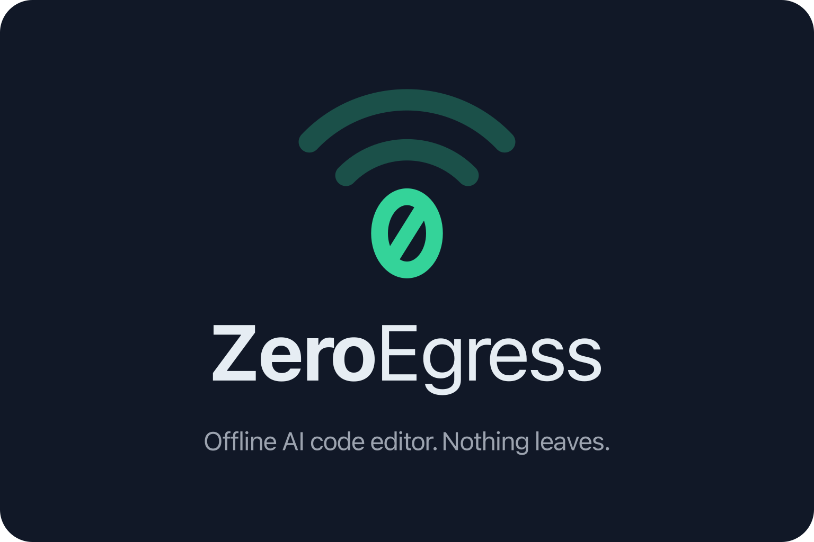

# ZeroEgress

ZeroEgress — offline AI code editor, built on [VSCodium](https://github.com/VSCodium/vscodium).

It talks only to the local model servers you configure (Ollama, vLLM, LM Studio): no telemetry, no auto-update, no online marketplace.

Building the installers is documented in [build/zero-egress/README.md](./build/zero-egress/README.md).

Licensed under Apache-2.0 (see [LICENSE.txt](./LICENSE.txt)); VS Code portions under MIT (see [LICENSE-VS-Code.txt](./LICENSE-VS-Code.txt)).
