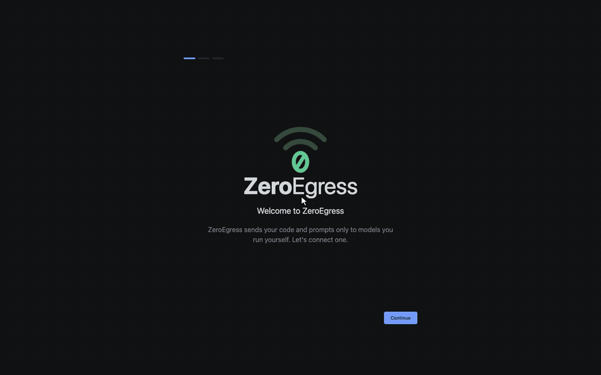

# ZeroEgress

[](https://github.com/sadayamuthu/zero-egress/actions/workflows/ci.yml)
[](https://github.com/sadayamuthu/zero-egress/releases/latest)
[](LICENSE.txt)

An AI code editor that works offline. ZeroEgress has chat, an agent mode,
quick edit and autocomplete, and talks only to model servers you run
yourself: Ollama, vLLM, LM Studio or oMLX on your laptop, or one on your own
network. It connects to loopback and to the servers you configure, and
nothing else. Telemetry, auto-update, the online extension marketplace,
analytics and cloud sign-in are removed. A runtime guard blocks every other
connection and logs it, so you can see what was stopped.



[Full-quality video](demo/zero-egress-demo.mp4) (MP4, 86 s). The model is
`qwen2.5-coder:7b` in Ollama on an M3 Max.

## What never leaves your machine

| What | Where it goes |
|------|---------------|
| Your code and prompts | Only to the model server you configured (and to MCP servers you added, when the agent calls their tools) |
| Chat history | Stays in the editor's local storage |
| Autocomplete and Quick Edit context | Only to the model server you configured |
| Telemetry and usage analytics | Nowhere. The analytics client is removed, and VS Code's telemetry has no endpoint to send to |
| Crash reports | Stay on disk. No upload URL is configured |
| Update checks | None. Updates are manual, from [Releases](https://github.com/sadayamuthu/zero-egress/releases) |
| Extension marketplace searches | None. There is no gallery; extensions install from `.vsix` files |
| Sign-in (GitHub, Microsoft), tunnels, remote development | Removed |
| The chat audit record | Off by default. With `zeroEgress.audit.enabled` on, a local file; sent to a collector only if you also set `zeroEgress.audit.collectorUrl` |

Any other connection is blocked and listed in the Output panel under
**ZeroEgress: Network**. [EGRESS.md](EGRESS.md) has the details, the known
limits, and how to check it yourself.

## Install

Download from the
[latest release](https://github.com/sadayamuthu/zero-egress/releases/latest).
`<v>` below is the version number, for example `0.1.0`.

**Homebrew** (macOS): coming soon. The `sadayamuthu/tap` cask does not exist
yet; use the `.dmg` below.

**macOS** (`.dmg`): `ZeroEgress-<v>-arm64.dmg` for Apple silicon,
`ZeroEgress-<v>-x64.dmg` for Intel. Open it and drag ZeroEgress to
Applications.

**Windows** (`.exe`, x64): `ZeroEgress-<v>-x64-user-setup.exe` installs for
your account only and needs no administrator rights;
`ZeroEgress-<v>-x64-setup.exe` installs for all users.

**Debian / Ubuntu** (`.deb`, amd64):

```sh
sudo apt install ./zero-egress_<v>_amd64.deb
```

Do not install the **0.1.0** `.deb`: it registers Microsoft's apt repository
(see [the advisory](docs/release/v0.1.0-deb-advisory.md) for what it did and
how to clean up). On Debian and Ubuntu, use the AppImage or the `.tar.gz`
from 0.1.0 until a later release ships a fixed `.deb`.

**Fedora / RHEL** (`.rpm`, x86_64):

```sh
sudo dnf install ./zero-egress-<v>-1.x86_64.rpm
```

**AppImage** (x86_64, any distribution):

```sh
chmod +x ZeroEgress-<v>-x86_64.AppImage
./ZeroEgress-<v>-x86_64.AppImage
```

**Archive** (`.tar.gz`, x64): unpack it anywhere and run the `zero-egress`
executable in the extracted folder.

```sh
tar -xzf zero-egress-<v>-linux-x64.tar.gz
```

### Unsigned builds

A release built without signing certificates has `-unsigned` before the
extension, for example `ZeroEgress-<v>-arm64-unsigned.dmg` or
`ZeroEgress-<v>-x64-setup-unsigned.exe`. The operating system warns the
first time you open one.

- **macOS** refuses to open it the first time because it can't verify the
  developer. On macOS 14 or earlier, Control-click (or right-click)
  ZeroEgress in Applications, choose **Open**, then **Open** again. On
  macOS 15 or later, open it once, then go to **System Settings → Privacy &
  Security** and click **Open Anyway**. Or clear the quarantine flag from a terminal:

  ```sh
  xattr -dr com.apple.quarantine /Applications/ZeroEgress.app
  ```

- **Windows** SmartScreen shows "Windows protected your PC". Click
  **More info**, then **Run anyway**. A build signed with an OV
  (organization validated) certificate can show the same warning until that
  certificate has built up download reputation with Microsoft.

## Connect a model

Local Ollama, in three steps:

1. Install Ollama from [ollama.com/download](https://ollama.com/download)
   and start it.
2. Pull a coding model:

   ```sh
   ollama pull qwen2.5-coder:7b
   ```

3. Open ZeroEgress. The first-run screen finds Ollama at
   `http://127.0.0.1:11434` and lists its models. Press **Cmd+L**
   (**Ctrl+L** on Windows and Linux) to chat, and **Cmd+K** (**Ctrl+K**) to
   edit the selected code.

vLLM (default `http://localhost:8000`), LM Studio (default
`http://localhost:1234`) and oMLX (default `http://127.0.0.1:8000`) work the
same way: start the server, and change the endpoint in ZeroEgress Settings
if yours is different. If the server requires an API key (common with
oMLX), enter it in the optional **API Key** field. Open Settings with the
gear at the top of the chat panel, or run **ZeroEgress: Open Settings**
from the Command Palette. Endpoints are under **Local Providers**.
Autocomplete is off by default; turn it on under **Feature Options**.

## Use a model server on your network

Run the model on a bigger machine and point ZeroEgress at it. In
ZeroEgress Settings, under **Local Providers**, set the endpoint to the
server's address, for example:

- vLLM / oMLX: `http://192.168.1.50:8000`
- Ollama: `http://192.168.1.50:11434`

Enter the address without `/v1`; ZeroEgress adds it. The guard allows that
host and port as soon as you enter it. If the address is not a private or
loopback address, Settings shows "This server is on the internet; code you
send will leave your network." It doesn't block it: you decide.

Ollama listens only on loopback by default. To reach it from other
machines, start it on the server with:

```sh
OLLAMA_HOST=0.0.0.0 ollama serve
```

If Ollama runs as the macOS app or a Linux service, set `OLLAMA_HOST`
there instead; see
[Ollama's FAQ](https://github.com/ollama/ollama/blob/main/docs/faq.md#how-do-i-configure-ollama-server).
vLLM takes `--host 0.0.0.0 --port 8000`. Either way, the model server is
then open to your whole network, so keep it behind your firewall. To check that your laptop can reach it:

```sh
curl http://192.168.1.50:11434/api/tags
```

## Verify a download

Each release has a `SHA256SUMS` file. Download it next to the installer,
then:

```sh
shasum -a 256 -c SHA256SUMS --ignore-missing     # macOS
sha256sum -c SHA256SUMS --ignore-missing         # Linux
```

Each file you downloaded should print `OK`. `SHA256SUMS` also covers the
CycloneDX SBOM (`zero-egress-<v>.cdx.json`). The SBOM lists the production
npm dependencies of the root lockfile only; it does not yet list the
built-in extensions' dependencies, Electron and Chromium, or the bundled
ripgrep. On Windows, compare
`Get-FileHash` with the line in `SHA256SUMS`:

```powershell
Get-FileHash .\ZeroEgress-<v>-x64-setup.exe -Algorithm SHA256
```

Signed builds can also be checked for their signature. On macOS:

```sh
codesign -dv --verbose=4 /Applications/ZeroEgress.app
spctl -a -vv /Applications/ZeroEgress.app
```

A signed, notarized build shows `Authority=Developer ID Application: …` from
`codesign` and `accepted` with `source=Notarized Developer ID` from `spctl`.
An unsigned build shows `Signature=adhoc` and is rejected by `spctl`. On
Windows:

```powershell
Get-AuthenticodeSignature .\ZeroEgress-<v>-x64-setup.exe | Format-List
```

A signed installer shows `Status : Valid`.

## Extensions

There is no online marketplace. Install extensions from `.vsix` files:
download the `.vsix` on a machine that has internet access (for example
from [open-vsx.org](https://open-vsx.org)), copy it over, then in
ZeroEgress open the Extensions view, click **…** at the top, and choose
**Install from VSIX...**.

Extensions you install run with the same rights as the editor. ZeroEgress
checks the network calls they make through Node and Electron in the
extension host, but not the programs they start. See
[EGRESS.md](EGRESS.md#known-limits).

## Egress and security

- [EGRESS.md](EGRESS.md): what was removed, how the runtime guard works,
  the known limits, and how to verify a release with a firewall or a
  logging proxy.
- [SECURITY.md](SECURITY.md): how to report a vulnerability. Any connection
  to a host you didn't configure counts.
- [CONTRIBUTING.md](CONTRIBUTING.md): building from source, tests and the
  release gates.

## Built on VSCodium

ZeroEgress is a fork of [VSCodium](https://github.com/VSCodium/vscodium),
the freely licensed build of Microsoft's
[VS Code](https://github.com/microsoft/vscode) source. Its AI features are
derived from Apache-2.0 code copyright Glass Devtools, Inc.; those files keep
their license headers. [ThirdPartyNotices.txt](ThirdPartyNotices.txt) lists
every upstream project and its license. ZeroEgress is not affiliated with
Microsoft or the VSCodium project.

## License

[Apache-2.0](LICENSE.txt) for ZeroEgress's additions and changes. The VS
Code portions are [MIT](LICENSE-VS-Code.txt).
